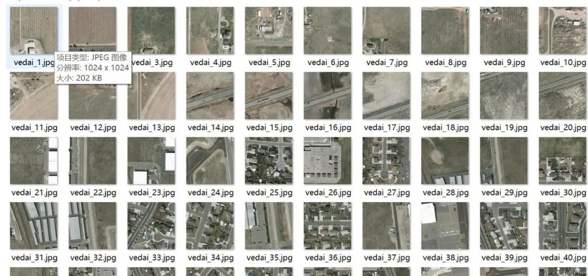
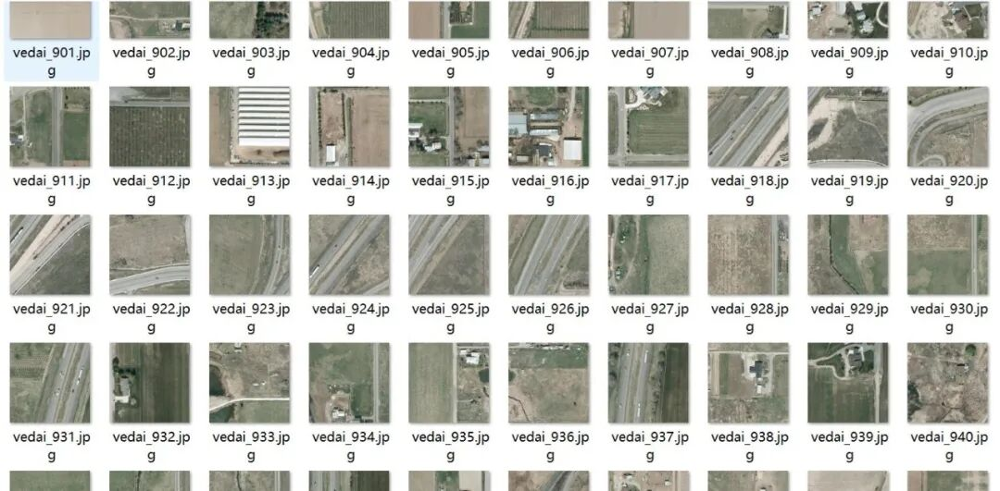
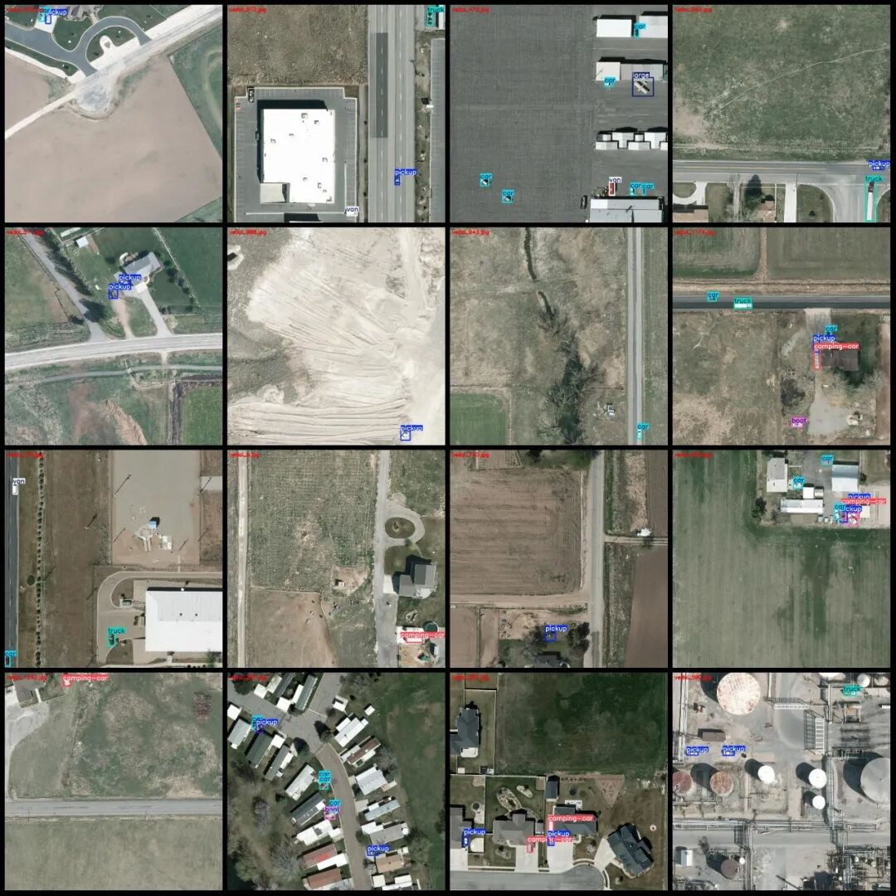
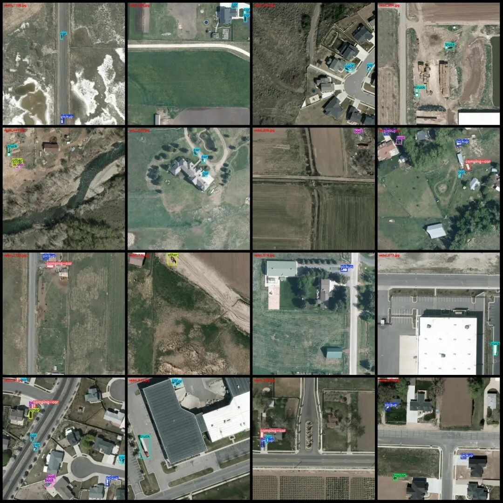

# Remote Sensing Image VEDAI dataset - Car, Truck, Airplane, etc. Detection Dataset in VOC+YOLO format with 1245 images across 11 categories

Dataset format: Pascal VOC format + YOLO format (txt file without split path, only containing jpg images and corresponding VOC format xml files and yolo format txt files)

Number of images (number of jpg files): 1245

Number of annotations (number of xml files): 1245

Number of annotations (number of txt files): 1245

Labeling category count: 11

Label category names (Note that the order of categories in the YOLO format does not correspond to this, but is based on the classes.txt file in the labels folder): ["boat", "bus", "camping-car", "car", "large", "motorcycle", "other", "pickup", "tractor", "truck", "van"]

Number of boxes labeled in each category:

Boat (ship) Frame Count = 170

Bus (bus) Frames = 3

Camping-car (RV/Trailer) Frame Count = 396

car (vehicle) frame count = 1364

Large (large vehicles) Frame Count = 47

Motorcycle (motorcycle) Frame Count = 4

Other (other) Frames = 202

Pickup (Truck) Frame Count = 949

Tractor (tractor) Frame Count = 190

Truck (truck) Frame Count = 305

Van (Box Truck) Frames = 100

Total frame count: 3730

Number of images per category:

Boat (ship) occupies 134 images.

Bus (public bus) occupies a picture count = 3

Camping-car (RV/Motorhome) occupies = 266

car (automobile) occupies = 696

Large (large vehicles) occupies a picture count = 20

Motorcycle (motorcycle) occupies a picture count = 4

other (Other) occupies = 136

Pickup (Truck) Ownership Image Count = 602

Tractor (tractor) occupies 149 images.

Truck (truck) occupies a picture count = 216

Van (Box Truck) occupies the image count = 87

Image resolution: 1024x1024

Using labelImg:

Annotation rules: Draw a rectangle around the category.

Important Notice: The dataset does not have separate training, validation, and test sets; you need to partition them yourself.

Special : This dataset does not guarantee the accuracy of the trained models or weight files.

Image Preview:

Annotation example:

## Payment

Here is a pay link on Stripe ( https://buy.stripe.com/3cs8yP7sY87d0vu9AB ). Please contact me lonlonago@foxmail.com after funding $89, and I will send you a complete data files , thank you!

